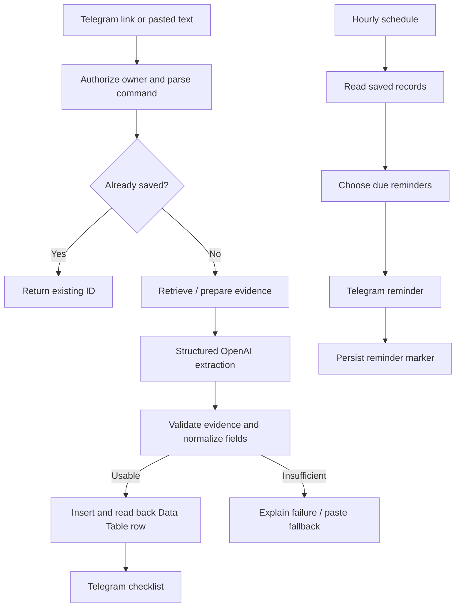

# Opportunity-to-Action Assistant

**Turn an opportunity link into a checklist you can actually work through.**

A private Telegram assistant built with n8n, OpenAI and n8n Data Tables. Hackathons, grants, bounties and builder programs often bury requirements across multiple pages. This project helps turn those requirements into a persistent action plan rather than a one-off summary.

**v0.4.0 — experimental, single-user release.** Verify critical requirements, eligibility and deadlines on the official source before submitting anything.

## What it does

- Accepts a public opportunity URL or pasted requirements.
- Retrieves the landing page and up to two relevant supporting pages via Jina Reader; includes a Devpost rules/calendar adapter.
- Extracts deadline, tasks, eligibility and submission information with source references; rejects unsupported quotes and links.
- Separates core required, conditional and optional tasks, and flags missing or uncertain evidence.
- Stores checklists in n8n Data Tables, preserves completed tasks on repeated `/add`, and verifies saves and task updates by reading back the row.
- Sends deadline reminders showing outstanding tasks, using persistent reminder markers.

## How it works

Pasted text uses its own deduplication key; the diagram abstracts the different input branches. `/list`, `/status`, `/done` and `/undo` operate on stored data without calling OpenAI.

## Quick start

1. Use an n8n installation with Data Tables, Code, Telegram and HTTP Request nodes. You need a Telegram bot, an OpenAI API key with API credits, and a reachable HTTPS webhook for Telegram.
2. Follow [SETUP.md](SETUP.md) to create storage, configure your owner ID and table ID, assign credentials and publish the workflow.
3. Send an official opportunity URL to the bot, then use `/status ID` to see evidence and warnings.

| Command | Purpose |
|---|---|
| `/add https://...` | Retrieve and save an opportunity (bare URLs also accepted) |
| `/paste <official text>` | Extract from pasted requirements (at least 200 characters; separate record) |
| `/list` | List saved opportunities (first 15 shown) |
| `/status ID [page]` | View tasks, evidence, eligibility and warnings |
| `/done ID:NUMBER` | Mark a task complete |
| `/undo ID:NUMBER` | Reopen a task |

## Validation and limitations

The development workflow was exercised with a developer grant, a Devpost hackathon, a Superteam bounty, pasted text, invalid/unreachable URLs, persistent task updates and manually triggered reminders. Restart recovery was reported working by the developer. Public-template smoke tests are included in [TESTING.md](TESTING.md); a fresh installation and automatic hourly schedule still require live verification.

Source coverage is bounded, some pages are blocked or dynamically rendered, and the model can miss or misclassify requirements. Quote verification checks text presence, not whether every claim is logically entailed. A missing deadline stays unconfirmed; conditional paths are selected manually. The system never submits applications or determines eligibility for you. Local reminders require n8n to stay running.

- [Setup](SETUP.md) · [Architecture](ARCHITECTURE.md) · [Testing](TESTING.md) · [Security and privacy](SECURITY.md)

## License

MIT. See [LICENSE](LICENSE). Third-party services retain their own terms and pricing. No affiliation with n8n, Telegram, Jina, OpenAI or opportunity platforms is implied.
